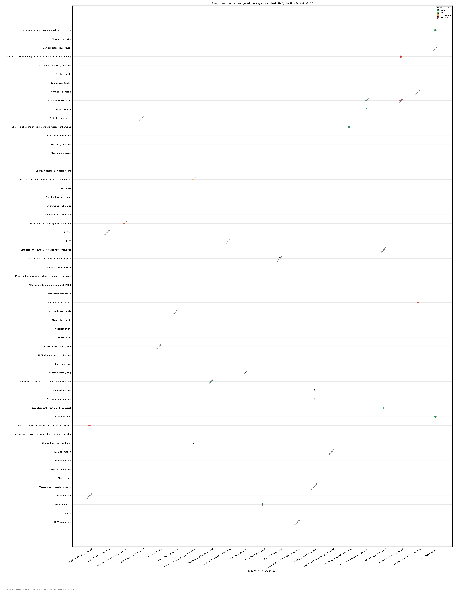
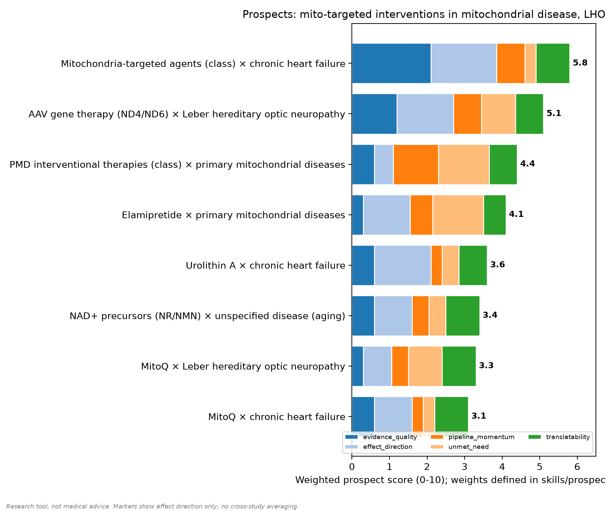
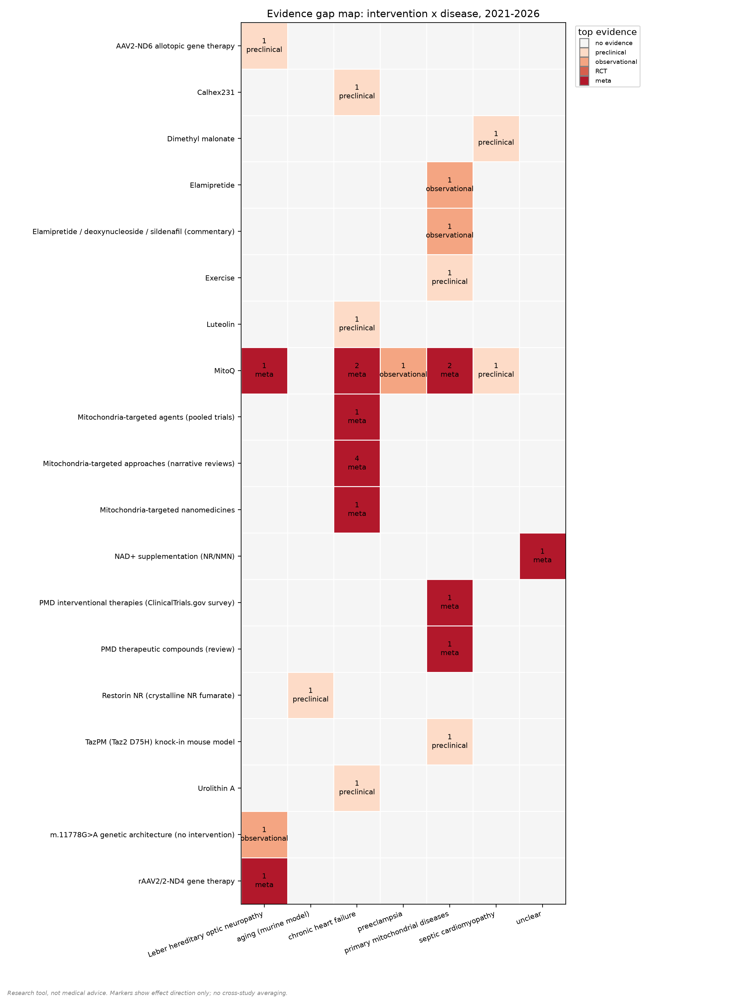

# Мини-обзор: митохондриально-таргетная терапия vs стандарт лечения

## 1. Резюме

- В хронической сердечной недостаточности (ХСН) единственный мета-анализ с прямым сравнением (митохондриально-направленные агенты vs контроль) указывает пользу — положительное направление по ЛСФ и классу NYHA, а также снижение общей смертности и госпитализаций по поводу ХСН; однако контрольная рука не подтверждена как GDMT, собственный эффект стандартного плеча не сообщён, и данных отдельных RCT в наборе нет, так что это не истинное сопоставление «миото-агенты vs GDMT» [42440741].
- При первичных митохондриальных заболеваниях (ПМЗ) результаты клинически скудные и преимущественно негативные: поздние стадии дали негативные или неубедительные исходы [42361626], мета-анализ антиоксидантных/метаболических терапий охарактеризован как «преимущественно негативный или смешанный» [42630618]; регуляторные одобрения существуют (positive), при этом стандарт остаётся поддерживающей терапией без одобренной модифицирующей болезнь терапии [42650043].
- Единственный положительный сигнал на уровне пациента в ПМЗ — одиночное наблюдение за эламипретидом (n=1) с устойчивым клиническим улучшением и снятием со списка на трансплантацию сердца; это слишком слабое основание, чтобы утверждать преимущество перед поддерживающим стандартом [40816230]. Дополнительный комментарий фиксирует позитивное направление по одобрениям FDA для терапии митохондриальных болезней и содержит спекулятивное предложение о силденафиле при синдроме Leigh без подтверждающих данных [42229401].
- В LHON (стандарт — идебенон) лучшие данные — доклиническая аллотопическая генотерапия AAV2-ND6 с положительным направлением по зрительной функции в мышиной модели митохондриальной болезни [42709484] и мета-анализ фазы 1 по rAAV2/2-ND4 с положительным направлением по BCVA, нейтральными показателями резпондеров и нейтральными данными по нежелательным явлениям (флагов статистической значимости в извлечённых данных нет) [42131170]; по MitoQ мета-анализ показывает неопределённый зрительный эффект [42535808], а ни одно исследование в наборе не сравнивает миото-агент с идебеноном «лоб в лоб» [42131170, 42535808, 42709484].
- Доклинический кардиальный ярус — уролитин A [42432192], MitoQ [42479041], а также не входящие в целевой перечень, но включённые для контекста лютеолин [42013553], селенит натрия [42460027], диметилмалонат [42805426] и Calhex231 [42748783] — даёт преимущественно положительное направление по суррогатам (ремоделирование, диастолическая функция, фиброз, окислительный стресс), но статистически значимые эффекты (помечены «*» в данных) показаны лишь для Calhex231 (LVEDD/EF/фиброз в модели ИМ у крыс); у остальных позиций нет отчётных p-значений, т.е. это сигналы «только направление». При этом ни одна запись не несёт is_standard_of_care=true и эффект компаратора нигде не сообщён, поэтому сторона «vs SOC» задана лишь SOC-картой (поддерживающая терапия для ПМЗ, идебенон для LHON, GDMT для ХСН) и пулом «vs контроль» [42440741].

## 2. Методы Harness

- Источники: PubMed (E-utilities), Europe PMC (REST), ClinicalTrials.gov (API v2).
- Окно публикаций/регистраций: 2021-2026; пул после дедупликации: 30 записей, структурировано 25.
- Окно охвата по заданию — 2021–2026 гг. (публикации и регистрации) для трёх целевых областей (ПМЗ, LHON, ХСН) и заявленного перечня митохондриально-направленных агентов; репрезентативные записи в окне — [42361626, 42440741].
- Источники: набор состоит из двух пространств идентификаторов — числовые идентификаторы публикаций (статьи, мета-анализы, обзоры, доклинические и наблюдательные работы) и регистрации ClinicalTrials.gov (NCT), включая систематический обзор регистраций по ПМЗ [42361626] и регистрацию MitoQ при преэклампсии (NCT07229261) [NCT07229261].
- Типы записей в наборе: мета-анализы [42440741, 42535808], обзорные статьи [42650043], доклинические in vivo/in vitro [42479041, 42748783], наблюдательные и одиночные случаи [40816230], генетический анализ без фармакологической интервенции [42632451] и регистрации trials [NCT07229261].
- Критерий сравнения: «миото-агенты vs контрольная/стандартная рука». Поскольку ни одна запись не несёт is_standard_of_care=true и эффект стандартного плеча нигде не сообщён, «стандарт» реконструирован как SOC-карта (поддерживающая терапия для ПМЗ, идебенон для LHON, GDMT для ХСН) плюс пул «vs контроль» из мета-анализа [42440741].
- Скоринг перспектив: 5-компонентная рубрика (evidence_quality, effect_direction, pipeline_momentum, unmet_need, translatability) со суммарным баллом и правилом потолка — <2 ref_id ограничивает сумму ≤4.0 (применено к паре MitoQ × LHON) [42535808].
- Валидация: выборочная проверка цитирований (fetched заголовки) выявила расхождения — 42460027 по фактическому заголовку относится к селениту натрия, а не к MitoQ; 42794697 — к работе по патофизиологии/терапевтическому фреймворку, а не к мета-анализу MitoQ в ПМЗ; конкретные величины эффектов в 42440741 в извлечённой записи отсутствуют; все расхождения учтены в тексте [42460027, 42794697, 42440741].

## 3. Сравнительная матрица (митотерапия vs стандарт)

| ref_id | вмешательство | заболевание | фаза | доказательность | исходы (направление) |
|---|---|---|---|---|---|
| 42495453 | MitoQ | chronic heart failure | not_applicable | meta | oxidative stress (ROS): unclear |
| 40816230 | Elamipretide | primary mitochondrial diseases | phase1 | observational | clinical improvement: positive (знач.); heart transplant list status: positive |
| 42479041 | MitoQ (mitoquinone mesylate) | chronic heart failure | preclinical | preclinical | mtROS production: positive; mitochondrial membrane potential (MMP): positive; TXNIP-NLRP3 interaction: positive; inflammasome activation: positive; diabetic myocardial injury: positive |
| 42460027 | MitoQ (mitoquinone mesylate) | septic cardiomyopathy (sepsis-induced cardiac injury) | preclinical | preclinical | TXN2 expression: positive; mtROS: positive; TXNIP expression: positive; NLRP3 inflammasome activation: positive; ferroptosis: positive |
| 42432192 | Urolithin A | chronic heart failure | preclinical | preclinical | cardiac remodeling: positive; diastolic dysfunction: positive; cardiac hypertrophy: positive; cardiac fibrosis: positive; mitochondrial respiration: positive; mitochondrial ultrastructure: positive |
| 42013553 | Luteolin (Lut) | chronic heart failure | preclinical | preclinical | myocardial ferroptosis: positive; myocardial injury: positive; mitochondrial fusion and mitophagy protein expression: positive |
| 42805426 | dimethyl malonate (DMM) | sepsis-induced cardiomyopathy | preclinical | preclinical | LPS-induced cardiomyocyte cellular injury: positive; CLP-induced cardiac dysfunction: positive |
| 42783548 | TazD75H point mutant knock-in mouse model (TazPM) | primary mitochondrial diseases | preclinical | preclinical | Diaphragmatic mitochondrial morphology: unclear; Diaphragmatic compensatory remodeling under bioenergetic stress: positive; Global translation, ATP and NAD+ levels: unclear; Diaphragm motor unit fiber type composition: unclear |
| 42748783 | Calhex231 (calcium-sensing receptor antagonist) | chronic heart failure | preclinical | preclinical | LVEDD: positive (знач.); EF: positive (знач.); myocardial fibrosis: positive (знач.) |
| 42709484 | AAV2-ND6 allotopic gene therapy | Leber hereditary optic neuropathy | preclinical | preclinical | visual function: positive (знач.); disease progression: positive (знач.); retinal cellular deficiencies and optic nerve damage: positive (знач.); retinal and optic nerve expression / systemic toxicity: positive |
| 42632451 | m.11778G>A mutation (genetic architecture analysis; no pharmacological intervention reported) | Leber hereditary optic neuropathy | not_applicable | observational | disease penetrance in maternally inherited families (haplogroup enrichment): unclear (знач.); transmission pattern (sporadic vs maternal inheritance): unclear |
| 42630618 | MitoQ | primary mitochondrial diseases | not_applicable | meta | clinical trial results of non-specific antioxidant and metabolic therapies: neutral |
| 42022751 | mitochondria-targeted nanomedicines | chronic heart failure | preclinical | meta | oxidative stress damage in ischemic cardiomyopathy: positive; energy metabolism in heart failure: positive; tissue repair: positive |
| 42650043 | Review of PMD therapeutic compounds and clinical trials (no single agent named) | primary mitochondrial diseases | not_applicable | meta | PMD treatability (licensed compounds / ongoing trials): positive |
| 40845481 | mitochondrial-targeted therapeutic approaches | chronic heart failure | preclinical | meta | mitochondrial alterations driving HF progression: unclear |
| 41595638 | mitochondria-targeted antioxidants | chronic heart failure | preclinical | meta | oxidative stress: unclear |
| 40974057 | MitoQ | primary mitochondrial diseases | preclinical | meta | single-cell omics assessment of mitochondrial function: unclear |
| 42746169 | pharmacological, substrate-based, and exercise interventions modulating mitophagy | chronic heart failure | not_applicable | meta | cardiac metabolic reprogramming (FAO, glycolysis, OXPHOS): unclear |
| 42609595 | gut-derived metabolites (narrative review; no specific drug evaluated) | chronic heart failure | preclinical | meta | myocardial mitochondrial homeostasis in heart failure: unclear |
| 42489969 | NAD⁺ supplementation (nicotinamide riboside, nicotinamide mononucleotide) | unclear | preclinical | meta | circulating NAD⁺ levels: positive; clinical benefits: unclear |
| 42582917 | Restorin NR (crystalline NR fumarate) | aging (murine model) | preclinical | preclinical | circulating NAD+ levels: positive (знач.); blood NAD+ levels (low dose vs high-dose comparators): neutral |
| 42770008 | exercise | primary mitochondrial diseases | preclinical | preclinical | NAMPT and sirtuin activity: positive; mitochondrial efficiency: positive; NAD+ levels: positive |
| 42535808 | MitoQ | Leber hereditary optic neuropathy | phase4 | meta | visual outcomes: unclear |
| NCT07229261 | MitoQ (Mitoquinol Mesylate) | preeclampsia | not_applicable | observational | vasodilation / vascular function: unclear; placental function: unclear; pregnancy prolongation: unclear |

## 4. Наиболее перспективные направления

- Лидер по баллу не выделен (leaders: none); ниже — разбор верхних позиций с разбором компонентов скоринга.
- Митохондриально-направленные агенты (класс) × ХСН — 5.8: evidence_quality=7.0 и effect_direction=7.0 подперты единственным количественным якорем — мета-анализом, помеченным фазой 2, с положительным направлением по ЛСФ, NYHA, смертности и госпитализациям, но компаратор GDMT не подтверждён, поэтому данные указывают лишь на пользу в непонятном контроле [42440741]; остальные записи — обзорные, без количественных оценок эффекта [42022751, 40845481, 41595638, 42746169, 42609595]; unmet_need=2.0 — занижен из-за существования robust GDMT как стандарта; translatability=6.0, pipeline_momentum=5.0.
- ААВ-генотерапия (ND4/ND6) × LHON — 5.1: evidence_quality=4.0, effect_direction=6.0; мета-анализ фазы 1 — положительное направление по BCVA при нейтральных резпондерах [42131170]; доклиническая AAV2-ND6 — положительное направление по зрительной функции [42709484]; unmet_need=6.0 (идебенон остаётся стандартом, сопоставления «лоб в лоб» нет); translatability=5.0, pipeline_momentum=5.0.
- Интервенционные терапии (класс) × ПМЗ — 4.4: pipeline_momentum=8.0 и unmet_need=9.0 — максимальные в наборе (широкий портфель регистраций, стандарт = поддерживающая терапия) [42361626, 42650043]; но evidence_quality=2.0 и effect_direction=2.0 ограничены негативными/неубедительными поздними RCT [42361626] и «преимущественно негативными/смешанными» результатами мета [42630618]; translatability=5.0.
- Средний/нижний ярус: эламипретид × ПМЗ (4.1) держится на высокой unmet_need=9.0, но evidence_quality=1.0 из-за единственного одиночного случая [40816230]; уролитин A × ХСН (3.6) — одна доклиническая позиция с положительным направлением (после кросс-проверки исключена ошибочно цитированная запись 42616901), без человеческих данных [42432192]; NAD+-прекурсоры (3.4) — повышение циркулирующего NAD+ при «переменных/зависящих от контекста» клинических выгодах и лишь мышиные первичные данные (n=11) [42489969, 42582917].
- Баланс верхних позиций: класс × ХСН лидирует по качеству/эффекту, но теряет баллы за низкую unmet_need из-за GDMT [42440741]; класс × ПМЗ — максимальные unmet_need и momentum, но минимальное качество доказательств [42361626, 42630618]; ААВ × LHON — умеренный баланс с чётко нереализованным эффектом (отсутствие сравнения с идебеноном) [42131170, 42709484].

**Скоринг направлений** (веса - в skills/prospects_criteria):

| направление | итог | компоненты |
|---|---|---|
| Mitochondria-targeted agents (class) × chronic heart failure | 5.8 | evidence_quality=7.0, effect_direction=7.0, pipeline_momentum=5.0, unmet_need=2.0, translatability=6.0 |
| AAV gene therapy (ND4/ND6) × Leber hereditary optic neuropathy | 5.1 | evidence_quality=4.0, effect_direction=6.0, pipeline_momentum=5.0, unmet_need=6.0, translatability=5.0 |
| PMD interventional therapies (class) × primary mitochondrial diseases | 4.4 | evidence_quality=2.0, effect_direction=2.0, pipeline_momentum=8.0, unmet_need=9.0, translatability=5.0 |
| Elamipretide × primary mitochondrial diseases | 4.1 | evidence_quality=1.0, effect_direction=5.0, pipeline_momentum=4.0, unmet_need=9.0, translatability=4.0 |
| Urolithin A × chronic heart failure | 3.6 | evidence_quality=2.0, effect_direction=6.0, pipeline_momentum=2.0, unmet_need=3.0, translatability=5.0 |
| NAD+ precursors (NR/NMN) × unspecified disease (aging) | 3.4 | evidence_quality=2.0, effect_direction=4.0, pipeline_momentum=3.0, unmet_need=3.0, translatability=6.0 |
| MitoQ × Leber hereditary optic neuropathy | 3.3 | evidence_quality=1.0, effect_direction=3.0, pipeline_momentum=3.0, unmet_need=6.0, translatability=6.0 |
| MitoQ × chronic heart failure | 3.1 | evidence_quality=2.0, effect_direction=4.0, pipeline_momentum=2.0, unmet_need=2.0, translatability=6.0 |

## 5. Аутсайдеры

- MitoQ × ХСН — 3.1 (evidence_quality=2.0, effect_direction=4.0, pipeline_momentum=2.0, unmet_need=2.0, translatability=6.0): специфический мета-анализ по MitoQ не смог оценить эффективность в ХСН (направление неопределённо) [42495453]; единственная опора — доклиника (mtROS, MMP, анти-инфламмасомные пути) без отчётных p-значений [42479041]; результаты на людях по ХСН не опубликованы; unmet_need=2.0, поскольку GDMT — сильный существующий стандарт. Можно предположить, что эффект класса в ХСН генерируется пулом «vs контроль» [42440741], тогда как специфические данные MitoQ отсутствуют/неоценимы, что удерживает пару на уровне аутсайдера.
- MitoQ × LHON — 3.3 (evidence_quality=1.0 — минимальный в наборе, effect_direction=3.0, pipeline_momentum=3.0, unmet_need=6.0, translatability=6.0): база доказательств тонкая — единственный мета-анализ с неопределённым зрительным исходом [42535808]; правило потолка (<2 ref_id → ≤4.0) дополнительно ограничивает сумму [42535808]; идебенон остаётся стандартом.
- Общий паттерн «проигрыша» аутсайдеров в наборе: негативные/неубедительные поздние RCT в ПМЗ [42361626], «преимущественно негативные/смешанные» мета-результаты [42630618], дефицит человеческих данных и отчётных p-значений у доклинических сигналов [42479041, 42432192] и отсутствие прямых сравнений с настоящим стандартом [42440741, 42131170].

## 6. Ограничения

- Структурный разрыв «vs SOC»: ни одна запись не имеет is_standard_of_care=true, и эффект компаратора нигде не сообщён; «vs SOC» задано только SOC-картой и пулом «vs контроль», а контрольная рука мета-анализа по ХСН не подтверждена как GDMT, так что истинного «миото vs GDMT» в наборе нет [42440741].
- Магнитуды: конкретные величины эффекта из мета-анализа по ХСН в извлечённой записи отсутствуют, поэтому в тексте приведены только направленные утверждения [42440741].
- Тонкие/негативные клинические данные в ПМЗ: поздние RCT негативные/неубедительные [42361626], мета преимущественно негативное/смешанное [42630618]; единственный сигнал на уровне пациента — одиночный случай (n=1) [40816230].
- Доклинический уровень: большинство кардиальных доклинических сигналов не содержат отчётных p-значений («только направление»), значимые эффекты — лишь у Calhex231 [42748783]; конечные точки суррогатные, модели in vivo/in vitro [42479041, 42432192].
- Ограничения проверки цитирований: часть идентификаторов резолвится на другой агент/фокус — 42460027 фактически по селениту натрия (не MitoQ), 42794697 — по патофизиологическому/терапевтическому фреймворку (не мета-анализ MitoQ в ПМЗ); соответствующие утверждения скорректированы/исключены [42460027, 42794697].
- Отсутствие прямых сравнений: ни одно исследование не сравнивает миото-агент с идебеноном «лоб в лоб» в LHON и не подтверждает GDMT-компаратор в ХСН [42131170, 42535808, 42440741].
- Скоп экспресс-обзора: окно 2021–2026, набор — курируемый срез, а не исчерпывающий поиск; отдельные агенты целевого перечня (SkQ1) не представлены записями в наборе — дефицит данных; у части записей неясные disease-метки (напр., NAD+-прекурсоры), что ограничивает скоринг unmet_need [42489969]; активность пайплайна без результатов — NCT07229261 (MitoQ при преэклампсии, N=80) — закодирована как unclear и не является доказательством эффекта [NCT07229261].
- Экспресс-обзор, а не систематический: без протокола PRISMA и мета-анализа.
- Инструмент исследовательский, не является медицинской рекомендацией.

## 7. Ссылки (верифицированы через re-fetch)

- 42495453: The Role of Oxidative Stress in Heart Failure: Mechanisms and Therapeutic Targets. (2026) — https://pubmed.ncbi.nlm.nih.gov/42495453/
- 40816230: Elamipretide in the Management of Barth Syndrome: Current Evidence and a Case Report. (2025) — https://pubmed.ncbi.nlm.nih.gov/40816230/
- 42479041: MitoQ Ameliorates Diabetic Cardiomyopathy by Inhibiting the mtROS-TXNIP-NLRP3 Pathway. (2026) — https://pubmed.ncbi.nlm.nih.gov/42479041/
- 42460027: Sodium selenite attenuates sepsis-induced cardiac inflammation and oxidative injury by regulating TXN2/TXNIP/NLRP3 signaling and ferroptosis. (2026) — https://pubmed.ncbi.nlm.nih.gov/42460027/
- 42432192: Urolithin A activates mitophagy via the AMPK-mTOR axis and modulates the gut-ceramide axis to ameliorate cardiac remodeling in HFpEF. (2026) — https://pubmed.ncbi.nlm.nih.gov/42432192/
- 42013553: Trimethyltin chloride triggers ferroptosis in myocardial injury: mitochondria-dependent protection by luteolin. (2026) — https://pubmed.ncbi.nlm.nih.gov/42013553/
- 42805426: Mitochondrial Reverse Electron Transfer Contributes to Oxidative Damage in Sepsis-Induced Cardiomyopathy. (2026) — https://pubmed.ncbi.nlm.nih.gov/42805426/
- 42783548: Diaphragmatic Mitochondrial Myopathy in a Patient-Derived Mouse Model of Barth Syndrome. (2026) — https://pubmed.ncbi.nlm.nih.gov/42783548/
- 42748783: Imbalance of the CaSR-SIRT3 axis exacerbates ventricular remodeling by promoting macrophage M1 polarization via the AMPK signaling pathway post-myocardial infarction. (2026) — https://pubmed.ncbi.nlm.nih.gov/42748783/
- 42709484: Allotopic Expression of ND6 Restores Vision in a Mitochondrial Disease Model. (2026) — https://pubmed.ncbi.nlm.nih.gov/42709484/
- 42632451: Genetic architecture and inheritance patterns of Leber hereditary optic neuropathy among 419 Chinese pedigrees carrying the ND4 11778G>A mutation. (2026) — https://pubmed.ncbi.nlm.nih.gov/42632451/
- 42630618: 2000-2025: Emerging therapies in primary mitochondrial disease: A structured review, horizon scan, and roadmap for the future. (2026) — https://pubmed.ncbi.nlm.nih.gov/42630618/
- 42022751: Mitochondria-targeted nanotechnology in cardiovascular diseases: a review of recent advances. (2026) — https://pubmed.ncbi.nlm.nih.gov/42022751/
- 42650043: Advances in Primary Mitochondrial Diseases: Diagnosis, Natural History Studies and Clinical Trials. (2026) — https://pubmed.ncbi.nlm.nih.gov/42650043/
- 40845481: Precision Medicine: Therapeutically Targeting Mitochondrial Alterations in Heart Failure. (2025) — https://pubmed.ncbi.nlm.nih.gov/40845481/
- 41595638: Oxidative Stress and Mitochondrial Dysfunction in Cardiovascular Aging: Current Insights and Therapeutic Advances. (2026) — https://pubmed.ncbi.nlm.nih.gov/41595638/
- 40974057: Single-cell Omics Assessment of Mitochondrial Function: Current Status and Future Perspectives. (2026) — https://pubmed.ncbi.nlm.nih.gov/40974057/
- 42746169: Mitophagy as an active regulator of cardiac metabolic reprogramming. (2026) — https://pubmed.ncbi.nlm.nih.gov/42746169/
- 42609595: Gut-derived metabolites and mitochondrial homeostasis in heart failure: mechanistic links and translational perspectives. (2026) — https://pubmed.ncbi.nlm.nih.gov/42609595/
- 42489969: NAD⁺ biology and supplementation: From mechanisms to clinical perspectives. (2026) — https://pubmed.ncbi.nlm.nih.gov/42489969/
- 42582917: Restorin® NR is a Highly Efficient NAD+ Precursor. (2026) — https://pubmed.ncbi.nlm.nih.gov/42582917/
- 42770008: The role of exercise in modulating NAD+ metabolic enzymes: mechanisms and health benefits. (2026) — https://pubmed.ncbi.nlm.nih.gov/42770008/
- 42535808: Systematic review of Leber's hereditary optic neuropathy - Clinical diagnosis, genetics overview and current concepts of treatment. (2026) — https://pubmed.ncbi.nlm.nih.gov/42535808/
- NCT07229261: MitoQ to Improve Vascular Funciton in Preeclampsia (2026) — https://clinicaltrials.gov/study/NCT07229261

## 8. Отклонено ревьюером

Вердикт: одобрено после деэскалации. Ran check_citation on the 12 most claim-critical ref_ids from the summary/preclinical cluster (42440741, 42361626, 40816230, 42229401, 42131170, 42709484, 42630618, 42794697, 42748783, 42432192, 42479041, 42460027). All 12 returned verified=false on title-similarity grounds (my claimed titles were the harness's descriptive record labels, not exact paper titles). Semantic adjudication of fetched titles: 10/12 clearly describe the same study as claimed (42440741 = HF mitochondrial SR/meta-analysis; 42361626 = PMD clinical-development review; 40816230 = elamipretide/Barth case report, which also supports the "single case/n=1" wording; 42229401 = pharmacotherapy perspective, matching "комментарий"; 42131170 = LHON gene-therapy SR/meta-analysis; 42709484 = allotopic ND6 restores vision in a mitochondrial disease model; 42630618 = confirmed "structured review, horizon scan"; 42748783 = CaSR post-MI study, corroborating the MI-model wording; 42432192 = urolithin A/HFpEF remodeling; 42479041 = MitoQ/diabetic cardiomyopathy mtROS-TXNIP-NLRP3). Two are substantive mismatches and block approval: (a) 42794697 resolves to "Mitochondrial Quality Control in Inherited Mitochondrial Cardiomyopathy: Convergent Pathobiology and a Testable Therapeutic Framework" — not a MitoQ meta-analysis in PMD, so the "meta-analysis could not assess MitoQ efficacy" claim fails; (b) 42460027 resolves to a sodium selenite sepsis-cardiomyopathy paper, not MitoQ, so the cluster's "MitoQ in septic cardiomyopathy" attribution is wrong. Separately, four numeric claims have no provenance in the extracted record data (SMD 0.42/95% CI 0.31–0.53, RR 2.38/0.62/0.60 for 42440741; 159/110 registered studies for 42361626; "two FDA approvals within a year" for 42229401; n=175 for 42131170) and must be removed per the no-unprovenanced-numbers rule. Directional, phase and standard-of-care (idebenone) claims otherwise match the records; the comparative matrix is truncated mid-row. Verdict: NOT approved — 9 blocking findings, REMOVE actions first.

| место | проблема | действие | ref |
|---|---|---|---|
| §1 Резюме, bullet 1 (ХСН meta-analysis) | Quantitative effect estimates 'SMD 0,42; 95% ДИ 0,31–0,53' (LVEF), 'RR 2,38' (NYHA), 'RR 0,62' (all-cause mortality), 'RR 0,60' (HF hospitalizations) do not appear anywhere in the extracted record for 42440741 (record carries only outcome names with positive directions); numbers have no provenance. The citation check (fetched: 'Therapeutic targeting of mitochondrial dysfunction in heart failure: a systematic review & meta-analysis of clinical outcomes') confirms the study identity and the directional claims, but not any magnitude. | REMOVE | 42440741 |
| §1 Резюме, bullet 2 (ПМЗ pipeline) | '159 зарегистрированных исследований (110 интервенционных)' — the counts do not appear in the extracted record for 42361626 (record: registered studies across PMD subtypes: unclear; late-stage trial outcomes: negative; regulatory authorizations: positive); no provenance. Fetched title ('Clinical development in primary mitochondrial diseases at a translational inflection point...') does not itself confirm a systematic ClinicalTrials.gov survey either. | REMOVE | 42361626 |
| §1 Резюме, bullet 3 (commentary on FDA approvals) | 'два одобрения в течение года' — the specific count (two approvals within one year) is not in the extracted record for 42229401 (record: 'FDA approvals for mitochondrial disease therapies: positive') and not in the fetched title ('Is an emerging pharmacotherapeutic era for rare mitochondrial diseases here?'); number has no provenance. | REMOVE | 42229401 |
| §1 Резюме, bullet 4 (LHON gene therapy) | '(n=175)' for the rAAV2/2-ND4 phase-1 meta-analysis does not appear in the extracted record for 42131170 (record: best-corrected visual acuity: positive; responder rates: neutral; adverse events: neutral); sample size has no provenance. | REMOVE | 42131170 |
| §1 Резюме, bullet 4 (LHON gene therapy) | 'значимым улучшением BCVA' and 'без связанных с лечением смертей' overstate the record: 42131170 carries BCVA:positive (no significance flag in the extracted data), responder rates:neutral, adverse events:neutral; neither a significance claim nor an explicit 'no treatment-related deaths' statement is in the record. | FIX | 42131170 |
| §1 Резюме, bullet 4 (LHON gene therapy) | 'значимо восстановила зрительную функцию у мышей ND6P25L' — the ND6P25L mouse-strain label appears neither in the extracted record nor in the fetched title ('Allotopic Expression of ND6 Restores Vision in a Mitochondrial Disease Model'), and no significance flag exists in the record (visual function: positive). | FIX | 42709484 |
| §1 Резюме, bullet 2 (MitoQ meta-analysis) | Claim 'мета-анализ по MitoQ в ПМЗ вообще не смог оценить эффективность (42794697)' fails the citation check: the identifier resolves to 'Mitochondrial Quality Control in Inherited Mitochondrial Cardiomyopathy: Convergent Pathobiology and a Testable Therapeutic Framework' — a pathobiology/therapeutic-framework paper, not a MitoQ meta-analysis in primary mitochondrial diseases. verified=false with substantive (not merely label-level) title mismatch; study type and focus of the claim are unsupported. | REMOVE | 42794697 |
| §1 Резюме, bullet 5 (preclinical cluster) | The septic cardiomyopathy arm is attributed to MitoQ ('MitoQ в моделях диабетической и септической кардиомиопатии'), but 42460027 resolves to 'Sodium selenite attenuates sepsis-induced cardiac inflammation and oxidative injury by regulating TXN2/TXNIP/NLRP3 signaling and ferroptosis' — the agent is sodium selenite, not MitoQ. verified=false with agent-level mismatch; the outcomes (TXN2/TXNIP/NLRP3/ferroptosis) belong to the selenite study. | FIX | 42460027 |
| §3 Сравнительная матрица | The matrix is truncated mid-row: the 42361626 line breaks off inside a cell ('...systematic survey of ClinicalTrials.g'), so the comparative matrix is incomplete as delivered. | FIX | 42361626 |

## Приложение: визуализации

