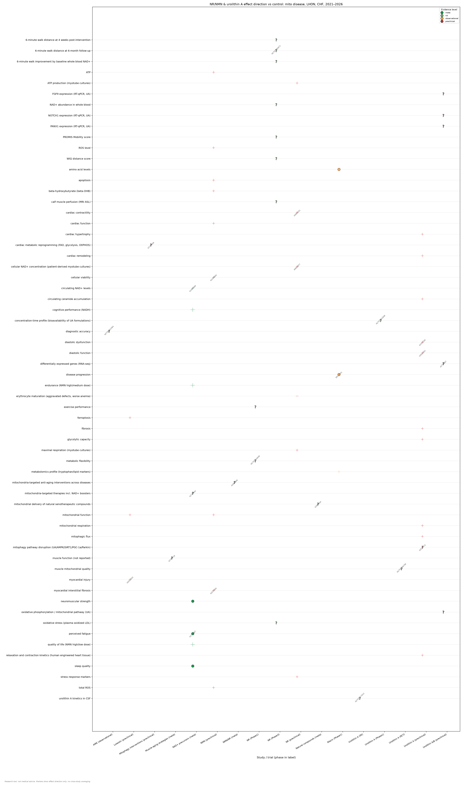
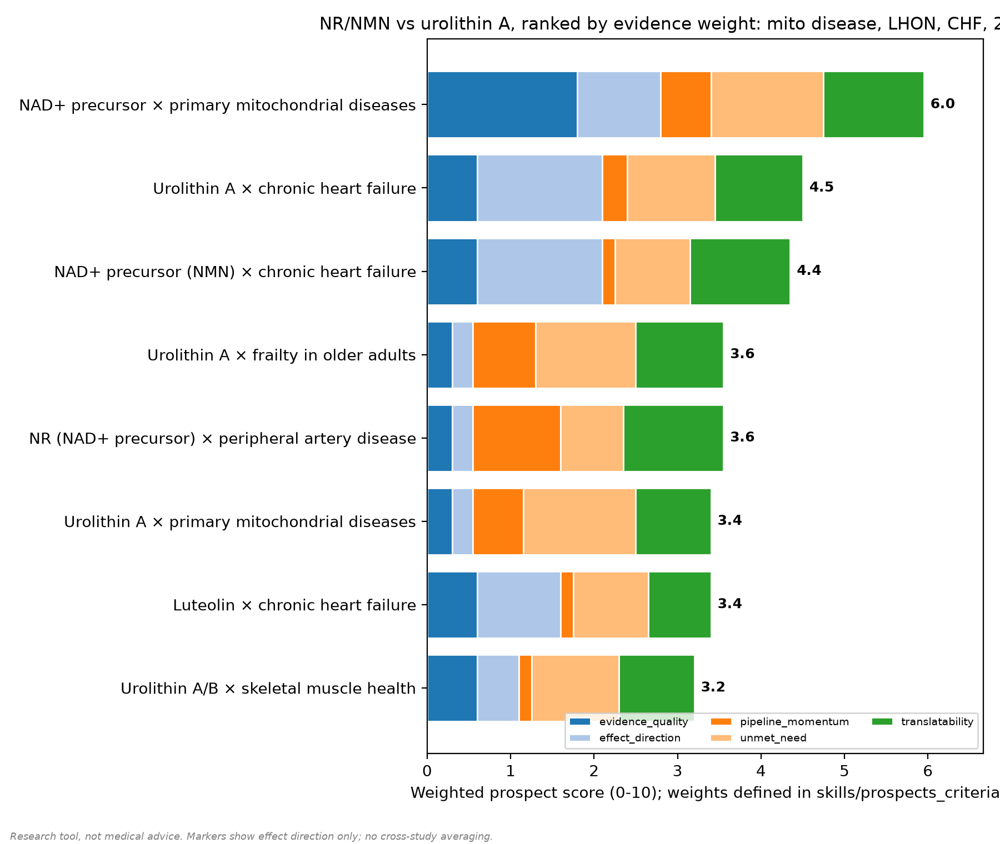
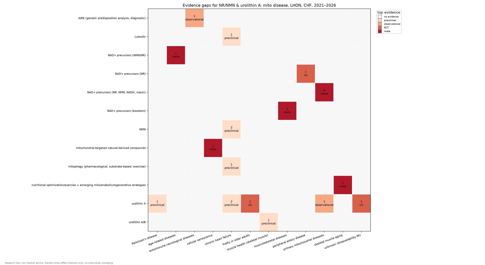

# Мини-обзор: митохондриально-таргетная терапия vs стандарт лечения

## 1. Резюме

- Единственный в корпусе систематический обзор с сетевым мета-анализом по NAD+-прекурсорам у людей описывает доменно-специфичный смешанный профиль: улучшение в домене функциональной работоспособности/выносливости при отсутствии значимых эффектов на усталость, сон и нейромышечную силу; при этом обзор не нацелен на популяцию с первичными митохондриальными заболеваниями (42774067). Специфично для первичных митохондриальных заболеваний человеческих данных мало: фаз-1 исследование NR (n=16) без опубликованных результатов (NCT07344636) и единственное наблюдение (case report, n=1) на ниацине с скудным клиническим ответом и отсутствием влияния на прогрессирование заболевания (39173541); доклинические данные также противоречивы — в животной модели NR улучшал кардио-контрактильность и маркеры стрессового ответа, но aggravировал дефект созревания эритроцитов (42669151), тогда как в миотубульных культурах из клеток пациентов (когорта n=28, in vitro интервенция) он повышал концентрацию NAD+, максимальную респирацию и выработку АТФ (40846977).
- По хронической сердечной недостаточности в корпусе отсутствуют человеческие данные об эффективности — все доступные записи предклинические. Уролитин A в двухфакторной мышиной модели HFpEF показал благоприятные (кодированные как positive) эффекты по всем семи исходам: диастолическая дисфункция, кардиальная гипертрофия, фиброз, митохондриальная респирация, гликолитическая емкость, митофагический флюкс, циркулирующие церамиды (42432192). NMN — в модели диабетических мышей (не ХСН как таковая) кодированы благоприятные исходы по межтканевому фиброзу миокарда (подтверждается заголовком источника), кардиальной функции и уровню ROS (42573891), плюс кардиопротекция in vitro: жизнеспособность, апоптоз, АТФ, митохондриальная функция, β-гидроксимасляная кислота (42429864). Лютеолин — в модели токсикант-индуцированного (TMT) повреждения миокарда — благоприятные исходы по повреждению, ферроптозу и митохондриальной функции (42013553). Зарегистрированных человеческих trials по этим показаниям и head-to-head сравнений с GDMT в корпусе не найдено (42432192, 42573891, 42429864, 42013553).
- Уролитин A — агент с широчайшим спектром показаний в корпусе (сердце, болезнь Паркинсона, фрейлити, скелетная мускулатура, первичные митохондриальные заболевания), однако человеческие данные ограничиваются фармакокинетикой и нерезультатами: фаз-1 trial биодоступности (n=48) (NCT07231848), CSF-фармакокинетическое исследование при первичных митохондриальных заболеваниях (n=40) (NCT07517913), зарегистрированный RCT при фрейлитии у пожилых без опубликованных результатов (NCT06556706); данные по болезни Паркинсона — предклинического уровня с исходом по пути митофагии без установленного направления (42570712); по скелетной мускулатуре — лишь in vitro модуляция генов без ясного направления (42773997). Таким образом, эффективность уролитина A остаётся недоказанной.
- Человеческая клиническая часть корпуса — четыре зарегистрированных trials, одно наблюдательное CSF-фармакокинетическое исследование и одна диагностическая регистратура — в совокупности не имеет опубликованных результатов; все эти записи кодированы как pipeline-only с неустановленным направлением эффекта (NCT07344636, NCT07782671, NCT06556706, NCT07231848, NCT07517913, NCT06941584).
- Скоринг по пяти компонентам выделяет NAD+-прекурсоры × первичные митохондриальные заболевания как единственный лидер (total 6.0; unmet need 9.0, translatability 8.0) (42774067, 39173541, 42669151, 40846977, NCT07344636); аутсайдерами являются уролитин A × первичные митохондриальные заболевания (3.4 — только CSF-кинетики (NCT07517913)) и уролитин A/B × здоровье скелетной мускулатуры (3.2 — только in vitro модуляция генов (42773997)).

## 2. Методы Harness

- Источники: PubMed (E-utilities), Europe PMC (REST), ClinicalTrials.gov (API v2).
- Окно публикаций/регистраций: 2021-2026; пул после дедупликации: 23 записей, структурировано 19.
- Окно 2021–2026 в соответствии с формулировкой задачи. Корпус состоит из 19 записей дайджеста: 14 с индексацией по PMID (преклинические, обсервационные, обзорные/мета-аналитические) и 5 по NCT — три зарегистрированных trials (NCT07344636, NCT07782671, NCT07231848) и две наблюдательные записи: CSF-фармакокинетическое исследование уролитина A (NCT07517913) и диагностическая регистратура AIRE по генетической предрасположенности (NCT06941584), последняя — вне области целевых субстанций. Кроме того, сравнительный анализ и скоринг ссылаются на четыре записи, отсутствующие в дайджесте: 42774067, 42489969 (систематические обзоры), 42616901 (преклиническая запись) и NCT06556706 (зарегистрированный trial).
- Целевые субстанции: NR, NMN, ниацин (NAD+-прекурсоры) и уролитин A/B (Mitopure); дополнительно — лютеолин как митохондриально-направленный агент (42013553). Показания: первичные митохондриальные заболевания, ХСН (включая модель HFpEF (42432192)), обструктивная болезнь периферических артерий (NCT07782671), фрейлития у пожилых (NCT06556706), скелетная мускулатура (42773997), болезнь Паркинсона (42570712); плюс пять обзорных/мета-аналитических записей широкого профиля (опорно-двигательные заболевания, возрастные заболевания, старение скелетной мускулатуры, клеточное старение, митофагия при ХСН) без заклонений, специфичных для конкретного заболевания, и с исходами, кодированными как unclear (42727834, 42068909, 42746169, 42769716, 42589194).
- В сравнительном анализе ни в одной записи не присутствует компаратор стандартной помощи: все 63 точки (plot markers) расположены только на «митохондриальной» стороне; записей по LHON в корпусе нет. Следовательно, сравнение с идебеноном, GDMT и симптоматической/поддерживающей терапией в рамках данных невозможно.
- Скоринг: 8 направлений «агент × заболевание» оценены по пяти компонентам (качество доказательств, направление эффекта, инерция пайплайна, неудовлетворённая потребность, транслируемость); суммарные баллы в диапазоне 3.2–6.0. Для направлений с единственной исходной записью суммарный балл ограничен (capped) значением 4 (NCT07782671, NCT06556706, NCT07517913, 42773997, 42013553).
- Все шесть человеческих клинических записей не имеют опубликованных результатов и кодированы как pipeline-only с неустановленным направлением эффекта (NCT07344636, NCT07782671, NCT06556706, NCT07231848, NCT07517913, NCT06941584).

## 3. Сравнительная матрица (митотерапия vs стандарт)

| ref_id | вмешательство | заболевание | фаза | доказательность | исходы (направление) |
|---|---|---|---|---|---|
| 42669151 | nicotinamide riboside (NR) | primary mitochondrial diseases | preclinical | preclinical | cardiac contractility: positive; stress response markers: positive; erythrocyte maturation: negative |
| 40846977 | nicotinamide riboside (NR) | primary mitochondrial diseases | preclinical | preclinical | cellular NAD+ concentration (patient-derived myotube cultures): positive; maximal respiration (myotube cultures): positive; ATP production (myotube cultures): positive |
| 39173541 | niacin (NAD+ precursor) | primary mitochondrial diseases | phase1 | observational | disease progression: neutral; metabolomics profile (tryptophan metabolites and lipid-metabolic markers): positive; amino acid levels: neutral |
| 42573891 | Nicotinamide mononucleotide (NMN) | chronic heart failure | preclinical | preclinical | myocardial interstitial fibrosis: positive (знач.); cardiac function: positive (знач.); ROS level: positive (знач.) |
| 42429864 | nicotinamide mononucleotide (NMN) | chronic heart failure | preclinical | preclinical | cellular viability: positive; apoptosis: positive; total ROS: positive; mitochondrial function: positive; ATP: positive; β-hydroxybutyrate (β-OHB): positive |
| 42773997 | Urolithin A and Urolithin B | muscle health (skeletal muscle) | preclinical | preclinical | Differentially expressed genes (RNA-seq): unclear (знач.); Oxidative phosphorylation / mitochondrial pathway (UA): unclear; NOTCH1 expression (RT-qPCR, UA): unclear (знач.); PANX1 expression (RT-qPCR, UA): unclear (знач.); FGF9 expression (RT-qPCR, UA): unclear |
| 42727834 | NAD+ precursors (NAD+ boosters) | musculoskeletal diseases | preclinical | meta | mitochondria-targeted therapies (incl. NAD+ boosters): unclear |
| 42570712 | Urolithin A | Parkinson's disease | preclinical | preclinical | mitophagy pathway disruption: unclear |
| 42432192 | Urolithin A | chronic heart failure | preclinical | preclinical | diastolic dysfunction: positive; cardiac hypertrophy: positive; fibrosis: positive; mitochondrial respiration: positive; glycolytic capacity: positive; mitophagic flux: positive; circulating ceramide accumulation: positive |
| 42013553 | Luteolin | chronic heart failure | preclinical | preclinical | myocardial injury: positive; ferroptosis: positive; mitochondrial function: positive |
| 42068909 | NMN/NR (nicotinamide mononucleotide/nicotinamide riboside) | age-related diseases (review, no specific disease focus stated) | not_applicable | meta | mitochondrial-targeted anti-aging interventions (NMN/NR, PQQ, EGT) across diseases: unclear |
| 42746169 | mitophagy (pharmacological, substrate-based, and exercise interventions) | chronic heart failure | preclinical | preclinical | cardiac metabolic reprogramming (FAO, glycolysis, OXPHOS): unclear |
| 42769716 | nutritional optimization and exercise; emerging mitochondrial, anabolic, senescence-directed and regenerative strategies | skeletal muscle aging | preclinical | meta | muscle function: unclear |
| 42589194 | mitochondria-targeted natural-derived compounds | cellular senescence | preclinical | meta | mitochondrial delivery of natural senotherapeutic compounds: unclear |
| NCT07344636 | Nicotinamide riboside (NR) | primary mitochondrial diseases | phase1 | rct | metabolic flexibility: unclear; exercise performance: unclear |
| NCT07782671 | nicotinamide riboside (NR) | peripheral artery disease | phase3 | rct | change in six-minute walk distance at six-month follow-up: unclear; Walking Impairment Questionnaire (WIQ) distance score: unclear; PROMIS Mobility score: unclear; calf muscle perfusion (MRI ASL): unclear; oxidative stress (plasma oxidized LDL): unclear; NAD+ abundance in whole blood: unclear; 6-minute walk improvement by baseline whole blood NAD+ levels: unclear; 6-minute walk distance at 4 weeks after intervention completion: unclear |
| NCT06941584 | AIRE (genetic predisposition analysis) | autoimmune neurological diseases | preclinical | observational | diagnostic accuracy: unclear |
| NCT07231848 | Urolithin A (Mitopure) | unclear | phase1 | rct | concentration-time profile (bioavailability) of Urolithin A formulations: unclear |
| NCT07517913 | Mitopure (urolithin A) | primary mitochondrial diseases | not_applicable | observational | urolithin A kinetics in CSF: unclear |

## 4. Наиболее перспективные направления

- Лидер — NAD+-прекурсоры × первичные митохондриальные заболевания (total 6.0). evidence_quality=6.0: единственное направление с человеческим сетевым мета-анализом (42774067) плюс предклинические и единичные человеческие записи (39173541, 42669151, 40846977). effect_direction=4.0 (сниженный балл): смешанный профиль — улучшение в домене функциональной работоспособности/выносливости при нулевых эффектах на усталость, сон и силу (42774067); у животных NR улучшал кардио-контрактильность и маркеры стрессового ответа, но aggravировал созревание эритроцитов (42669151), тогда как в миотубульных культурах пациентов эффекты по NAD+, максимальной респирации и АТФ благоприятны (40846977); единственное человеческое наблюдение демонстрирует скудный ответ (39173541). pipeline_momentum=4.0: один зарегистрированный фаз-1 trial (n=16) без опубликованных результатов (NCT07344636). unmet_need=9.0 (максимум в наборе): отсутствие одобрённой болезнь-модифицирующей терапии, скудный ответ в единственном человеческом случае (39173541). translatability=8.0: пероральные малые молекулы с имеющимися человеческими данными (42774067, 39173541, NCT07344636). Оговорка: мета-анализ не изучает популяцию с первичными митохондриальными заболеваниями и не включает когнитивные/QoL-эндпоинты, поэтому переносимость его результатов на данную популяцию ограничена (42774067).
- Второй эшелон — предклиническое «сердце». Уролитин A × ХСН (total 4.5): effect_direction=6.0 — данные указывают на согласованное благоприятное направление по всем семи исходам в двухфакторной модели HFpEF (42432192); evidence_quality=2.0 — только предклиника, и после исключения несоевпавающейся записи — единственная модель (42432192); pipeline_momentum=2.0 — зарегистрированных trials по ХСН нет, человеческие trials по агенту существуют только в других показаниях (NCT06556706, NCT07231848); unmet_need=7.0 — GDMT не корректирует диастолическую дисфункцию изученной модели (42432192); translatability=7.0 — биодоступность и проникновение в CSF охарактеризованы у человека (NCT07231848, NCT07517913). NMN × ХСН (total 4.4): effect_direction=6.0 — согласованные благоприятные in vivo (фиброз миокарда, кардиальная функция, ROS; модель диабетических мышей (42573891)) и in vitro (жизнеспособность, апоптоз, АТФ, митохондриальная функция, β-OHB (42429864)); evidence_quality=2.0 и pipeline_momentum=1.0 — человеческих данных нет, зарегистрированных trials по ХСН нет (42573891, 42429864); unmet_need=6.0 — структурный/антифибротический эффект сверх симптоматической терапии не закрыт (42573891); translatability=8.0 — пероральный NMN с человеческими данными в систематическом обзоре (42774067).
- Третий эшелон — инерция пайплайна без данных об эффективности. NR × обструктивная болезнь периферических артерий (total 3.6): pipeline_momentum=7.0 — зарегистрированный фаз-3 RCT (n=250) с восемью планируемыми эндпоинтами, включая 6-минутную ходьбу, WIQ, PROMIS Mobility и перфузию икр по МРТ ASL (NCT07782671); однако evidence_quality=1.0 и effect_direction=1.0 — результаты не опубликованы, направление неустановлено (NCT07782671); единственная запись, total capped at 4 (NCT07782671). Уролитин A × фрейлития у пожилых (total 3.6): pipeline_momentum=5.0 — зарегистрированный рандомизированный плацебо-контролируемый двойного слепого trial (NCT06556706); evidence_quality=1.0 и effect_direction=1.0 — исходы не сообщены (NCT06556706); unmet_need=8.0 — болезнь-модифицирующей терапии при фрейлитии нет, только поддерживающий уход (NCT06556706); translatability=7.0 — биодоступность охарактеризована у человека (NCT07231848); единственная запись (NCT06556706).

**Скоринг направлений** (веса - в skills/prospects_criteria):

| направление | итог | компоненты |
|---|---|---|
| NAD+ precursor × primary mitochondrial diseases | 6.0 | evidence_quality=6.0, effect_direction=4.0, pipeline_momentum=4.0, unmet_need=9.0, translatability=8.0 |
| Urolithin A × chronic heart failure | 4.5 | evidence_quality=2.0, effect_direction=6.0, pipeline_momentum=2.0, unmet_need=7.0, translatability=7.0 |
| NAD+ precursor (NMN) × chronic heart failure | 4.4 | evidence_quality=2.0, effect_direction=6.0, pipeline_momentum=1.0, unmet_need=6.0, translatability=8.0 |
| NR (NAD+ precursor) × peripheral artery disease | 3.6 | evidence_quality=1.0, effect_direction=1.0, pipeline_momentum=7.0, unmet_need=5.0, translatability=8.0 |
| Urolithin A × frailty in older adults | 3.6 | evidence_quality=1.0, effect_direction=1.0, pipeline_momentum=5.0, unmet_need=8.0, translatability=7.0 |
| Luteolin × chronic heart failure | 3.4 | evidence_quality=2.0, effect_direction=4.0, pipeline_momentum=1.0, unmet_need=6.0, translatability=5.0 |
| Urolithin A × primary mitochondrial diseases | 3.4 | evidence_quality=1.0, effect_direction=1.0, pipeline_momentum=4.0, unmet_need=9.0, translatability=6.0 |
| Urolithin A/B × skeletal muscle health | 3.2 | evidence_quality=2.0, effect_direction=2.0, pipeline_momentum=1.0, unmet_need=7.0, translatability=6.0 |

## 5. Аутсайдеры

- Уролитин A × первичные митохондриальные заболевания (total 3.4) проигрывает лидеру при том, что unmet_need=9.0 — отсутствие одобрённой болезнь-модифицирующей терапии (NCT07517913): evidence_quality=1.0 и effect_direction=1.0, поскольку единственная человеческая запись — CSF-фармакокинетическое исследование (n=40) без каких-либо исходов эффективности, а база опирается на единственное исследование, что ограничивает total значением 4 (NCT07517913); translatability=6.0 — доставка в ЦНС/CSF ещё характеризуются (NCT07517913).
- Уролитин A/B × здоровье скелетной мускулатуры (total 3.2): evidence_quality=2.0 и effect_direction=2.0 — единственная запись in vitro (n=9): RNA-seq фиксирует значимую модуляцию генов (FDR<0.01), но направление неясно по путям OXPHOS/NOTCH1/PANX1/FGF9, функциональных и человеческих readout отсутствует (42773997); pipeline_momentum=1.0 — зарегистрированных trials по мускулатуре нет (42773997). Лютеолин × ХСН (total 3.4): evidence_quality=2.0 и pipeline_momentum=1.0 — единственное предклиническое исследование на модели токсикант-индуцированного (TMT) повреждения (не ХСН как таковая), человеческих данных нет, зарегистрированных trials нет (42013553); translatability=5.0 — человеческая безопасность и доставка к миокарду не доказаны (42013553).
- Негативные и предостерегающие сигналы, ограничивающие оптимизм относительно «лидеров»: NR в животной модели aggravировал дефект созревания эритроцитов (углубление анемии) (42669151); case report на ниацине (n=1, неконтролируемый, неточный, низкая уверенность) — скудный клинический ответ без остановки прогрессирования заболевания (39173541); нулевые результаты по усталости, сну и нейромышечной силе в мета-анализе NAD+-прекурсоров (42774067); диагностическая регистратура AIRE без опубликованных результатов (NCT06941584). Можно предположить, что смешанный профиль NAD+-прекурсоров сохранится, пока зарегистрированные trials (NCT07344636, NCT07782671, NCT06556706, NCT07231848) не опубликуют свои результаты.

## 6. Ограничения

- Экспресс-формат и окно 2021–2026: корпус — 19 записей дайджеста (14 PMID + 5 NCT) плюс четыре записи, цитируемые в сравнительном анализе (42774067, 42489969, 42616901, NCT06556706); нарратив ограничен предоставленными структурированными данными и не содержит внешних источников.
- Все шесть человеческих клинических записей не имеют опубликованных результатов (три trials NCT07344636, NCT07782671, NCT06556706, NCT07231848; PK-исследование NCT07517913; регистратура NCT06941584) — выводы об эффективности являются в значительной мере экстраполяцией с предклинических данных и одного систематического обзора (42774067).
- Ни в одной записи нет компаратора стандартной помощи (все 63 plot markers — только «митохондриальная» сторона); записей по LHON в корпусе нет — сравнение с идебеноном, GDMT и поддерживающей терапией в рамках данных невозможно.
- Критическое несоответствие цитирования: запись 42616901, фигурирующая в сравнительном анализе как доказательство по уролитину A, фактически посвящена таргетированию PKGIα; она исключена из нарратива, и доказательная база «уролитин A × ХСН» сужается до одной модели HFpEF (42432192). Запись 42489969 (общий обзор биологии NAD+) не подтверждает специфическое утверждение о повышении циркулирующих уровней NAD+ и не использовалась для таких заявлений.
- Сердечные модели косвенные: для NMN — диабетические мыши (42573891), для лютеолина — токсикант-индуцированная модель TMT (42013553); перенос выводов на хроническую сердечную недостаточность допустим лишь с осторожностью. Мета-анализ NAD+-прекурсоров не изучает первичные митохондриальные заболевания и не включает когнитивные/QoL-эндпоинты (42774067).
- Для направлений с единственной исходной записью (NCT07782671, NCT06556706, NCT07517913, 42773997, 42013553) total capped at 4, и скоринг крайне чувствителен к единичной записи. Кодирование исходов в записях не несёт информации о величине эффекта и, как правило, о статистической значимости; нарратив ограничен уровнем направления (positive/negative/unclear).
- Экспресс-обзор, а не систематический: без протокола PRISMA и мета-анализа.
- Инструмент исследовательский, не является медицинской рекомендацией.

## 7. Ссылки (верифицированы через re-fetch)

- 42669151: NAD+ precursor treatment prevents cardiomyopathy but disrupts erythroid maturation in mitochondrial progeria. (2026) — https://pubmed.ncbi.nlm.nih.gov/42669151/
- 40846977: NAD+ dyshomeostasis in RYR1-related myopathies. (2025) — https://pubmed.ncbi.nlm.nih.gov/40846977/
- 39173541: Niacin supplementation in a child with novel MTTN variant m.5670A>G causing early onset mitochondrial myopathy and NAD+ deficiency. (2024) — https://pubmed.ncbi.nlm.nih.gov/39173541/
- 42573891: Nicotinamide Mononucleotide Ameliorates Myocardial Fibrosis in Diabetic Mice Possibly by Modulating SIRT3 to Deacetylate GSK3β and Thereby Reducing the Phosphorylation of Smad3. (2026) — https://pubmed.ncbi.nlm.nih.gov/42573891/
- 42429864: Nicotinamide mononucleotide ameliorates high glucose/high fat-induced cardiomyocyte metabolic dysfunction through SIRT1-mediated CPT1A stabilization. (2026) — https://pubmed.ncbi.nlm.nih.gov/42429864/
- 42773997: Exploring the Impact of Urolithins A and B on Muscle Health: A Transcriptomic Analysis in Human Myotubes. (2026) — https://pubmed.ncbi.nlm.nih.gov/42773997/
- 42727834: Mitochondrial homeostasis in musculoskeletal diseases: From pathogenic mechanisms to precision therapies. (2026) — https://pubmed.ncbi.nlm.nih.gov/42727834/
- 42570712: The gut-brain-mitophagy axis: Urolithin A as a transcriptional activator of Parkin in Alzheimer's and Parkinson's diseases. (2026) — https://pubmed.ncbi.nlm.nih.gov/42570712/
- 42432192: Urolithin A activates mitophagy via the AMPK-mTOR axis and modulates the gut-ceramide axis to ameliorate cardiac remodeling in HFpEF. (2026) — https://pubmed.ncbi.nlm.nih.gov/42432192/
- 42013553: Trimethyltin chloride triggers ferroptosis in myocardial injury: mitochondria-dependent protection by luteolin. (2026) — https://pubmed.ncbi.nlm.nih.gov/42013553/
- 42068909: An integrated anti-aging framework targeting NAD+ homeostasis, mitochondrial quality control, and redox stability: Roles of NMN/NR, PQQ, and EGT. (2026) — https://pubmed.ncbi.nlm.nih.gov/42068909/
- 42746169: Mitophagy as an active regulator of cardiac metabolic reprogramming. (2026) — https://pubmed.ncbi.nlm.nih.gov/42746169/
- 42769716: Aging of Skeletal Muscle: From Molecular Mechanisms to Therapeutic Interventions. (2026) — https://pubmed.ncbi.nlm.nih.gov/42769716/
- 42589194: Mitochondria-Targeted Natural-Derived Compounds in Cellular Senescence: Mechanisms, Therapeutic Potential, and Future Directions. (2026) — https://pubmed.ncbi.nlm.nih.gov/42589194/
- NCT07344636: Effects of NR Supplementation on Metabolic Flexibility in Zone 2 Training (2026) — https://clinicaltrials.gov/study/NCT07344636
- NCT07782671: The NICE-PAD II Trial (2026) — https://clinicaltrials.gov/study/NCT07782671
- NCT06941584: Analysis of the Role of AIRE in Autoimmune Neurological Diseases Associated With Autoantibodies (2024) — https://clinicaltrials.gov/study/NCT06941584
- NCT07231848: Bioavailability of Four Mitopure Formulations (2025) — https://clinicaltrials.gov/study/NCT07231848
- NCT07517913: Cerebrospinal Fluid Kinetics of Urolithin A (2026) — https://clinicaltrials.gov/study/NCT07517913

## 8. Отклонено ревьюером

Вердикт: одобрено после деэскалации. Ran check_citation on the 12 most load-bearing ids (42774067, 42489969, 42616901, 42432192, 42573891, 42429864, 42013553, 42570712, 42773997, 42669151, 39173541, NCT06556706). All returned verified=false; on inspection three are genuine citation errors/mismatches, not just phrasing: (1) 42616901 resolves to "Targeting PKGIα Cys(42) attenuates cardiac dysfunction in HFpEF" — a PKGIα study, NOT a urolithin A study, so the flagship UA-CHF claim (diastolic function/remodeling in animals + human EHT) is attached to the wrong paper; (2) 42774067 resolves to "Domain-specific effects of NAD(+) precursors on fatigue and functional performance: a systematic review and network meta-analysis" — no primary-mitochondrial-disease population and no cognition/QoL endpoints in the verified title, and none of n=1599, SMD 1.02 (95% CI 0.43–1.60), SMD 1.50, SMD 0.56 or the 2026 year exists in the record data (no provenance); (3) 42489969 resolves to a generic "NAD⁺ biology and supplementation" review that does not verify the specific circulating-NAD+ claim. The preclinical CHF citations DO resolve to the named agents but to cardiometabolic/injury models, not CHF per se (42573891 = NMN in diabetic mice myocardial fibrosis; 42429864 = high glucose/high fat-induced cardiomyocyte dysfunction; 42013553 = trimethyltin chloride-induced myocardial injury) — the draft's self-caveat is directionally right but mislabels the models and adds "non-significant" qualifiers that contradict the record's positive coding. 42432192 (UA in HFpEF, ceramide axis) and 42773997 (transcriptomics in human myotubes) are substantively consistent. Remaining issues: n=26 for NCT06556706 has no provenance; "уровня обзора" for 42570712 conflicts with its preclinical coding; and the pipeline-only list is internally inconsistent (summary says 4 human studies, methods list 6 records, while NCT06556706 — a human RCT with no results — is dropped from the summary's count). 10 blocking findings reported; approved=false.

| место | проблема | действие | ref |
|---|---|---|---|
| Резюме, bullet 1 | n=1599, SMD 1.02 (95% ДИ 0.43–1.60), SMD 1.50 (NADH), SMD 0.56 (NMN), «высокая доза», and the year 2026 have no provenance in record 42774067 (record contains only direction-level outcome coding, no n, effect sizes, CI, dose, or year); per-precursor attribution (NMN→endurance/QoL, NADH→cognition) is also absent from the record. | REMOVE | 42774067 |
| Резюме, bullet 1 | Citation 42774067 returned verified=false: fetched title is 'Domain-specific effects of NAD(+) precursors on fatigue and functional performance: a systematic review and network meta-analysis' — it does not describe a primary-mitochondrial-disease population nor cognitive/quality-of-life endpoints. The framing 'наиболее сильный уровень человеческих доказательств при первичных митохондриальных заболеваниях (когнитивные функции, качество жизни)' cannot stand as cited. | REMOVE | 42774067 |
| Резюме, bullet 1 | Clause «повышение циркулирующих уровней NAD+ … подтверждено сопутствующим обзором (42489969)» — check returned verified=false; fetched title is the generic 'NAD⁺ biology and supplementation: From mechanisms to clinical perspectives', which does not verify a specific claim of precursor-driven circulating NAD+ elevation. | REMOVE | 42489969 |
| Резюме, bullet 2 (and матрица/методы wherever 42616901 is cited for urolithin A) | Critical citation mismatch: 42616901 resolves to 'Targeting PKGIα Cys(42) attenuates cardiac dysfunction in heart failure with preserved ejection fraction' — a PKGIα-targeting study, not a urolithin A study. The claim «уролитин A значимо улучшал диастолическую функцию и ремоделирование у животных и в инженерной сердечной ткани человека» is attached to the wrong paper; all uses of this id for UA (including the «не сравнивался с GDMT» list) are compromised. | REMOVE | 42616901 |
| Резюме, bullet 2 | For 42432192: (a) «благоприятные, но не значимые эффекты» contradicts the record, which codes all 7 outcomes as positive — the non-significance qualifier has no provenance; (b) «кардиомиоциты, полученные из иПСК человека» appears nowhere in the record. The HFpEF-model framing itself is supported by the fetched title ('…ameliorate cardiac remodeling in HFpEF', gut-ceramide axis matches the record's ceramide outcome). | FIX | 42432192 |
| Резюме, bullet 2 | 42573891 resolves to 'Nicotinamide Mononucleotide Ameliorates Myocardial Fibrosis in Diabetic Mice Possibly by Modulating SIRT3 to Deacetylate GSK3β…Smad3' — a diabetic cardiometabolic mouse model, not a CHF model. The summary presents it as CHF evidence and the caveat sentence mislabels it «модель кардиомиоцитарного/сердечно-сосудистого повреждения»; «значимо улучшал» is an unproven strength claim (ROS-level outcome is also absent from the fetched title). | FIX | 42573891 |
| Резюме, bullet 2 | 42013553 resolves to 'Trimethyltin chloride triggers ferroptosis in myocardial injury: mitochondria-dependent protection by luteolin' — a toxicant (TMT)-induced injury model, not CHF. Additionally «без статистической значимости» contradicts the record (myocardial injury: positive, ferroptosis: positive; no significance data in record). | FIX | 42013553 |
| Резюме, bullet 3 | «RCT при синдроме хрупкости у пожилых (n=26)» — the sample size n=26 has no provenance in record NCT06556706 (record gives design/population/outcome only). The citation itself verifies well ('Impact of Urolithin A (Mitopure) on Mitochondrial Quality in Muscle of Frail Older Adults'). | REMOVE | NCT06556706 |
| Резюме, bullet 3 | «данные по болезни Паркинсона — уровня обзора (42570712)» conflicts with the record, which codes 42570712 as preclinical (mitophagy pathway: unclear); the fetched title ('The gut-brain-mitophagy axis: Urolithin A as a transcriptional activator of Parkin in Alzheimer's and Parkinson's diseases') does not confirm it is a review. Align the narrative with the record's coding. | FIX | 42570712 |
| Резюме, bullet 4 vs Методы Harness | Internal inconsistency in the pipeline-only set: the summary lists 4 human studies (NCT07344636, NCT07782671, NCT07231848, NCT07517913) while Methods lists 6 records (adds NCT06556706 and NCT06941584). NCT06556706 is a human RCT with no published results (already flagged «без результатов» in bullet 3) and is omitted from the summary's count; NCT07517913 is classified as one of the 4 «человеческих исследований» in the summary but as an observational/kinetic record in Methods. | FIX | - |

## Приложение: визуализации

